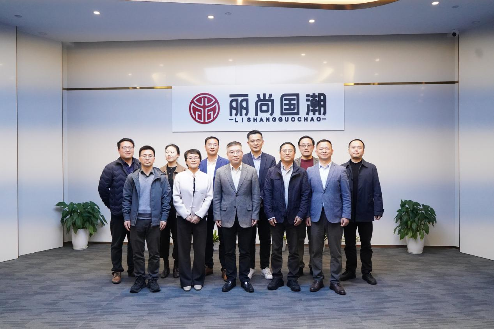
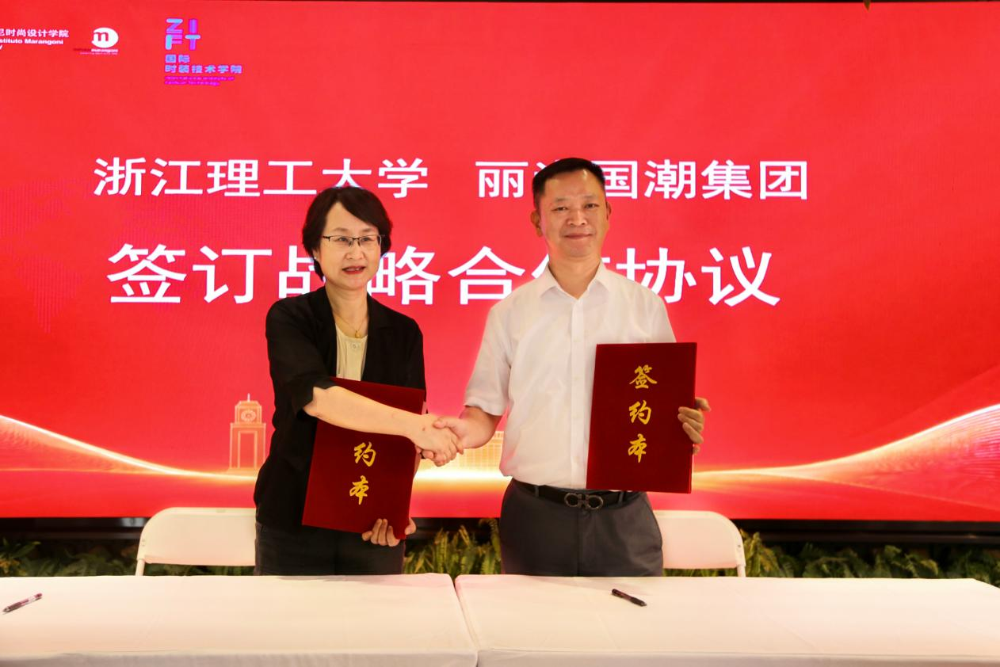
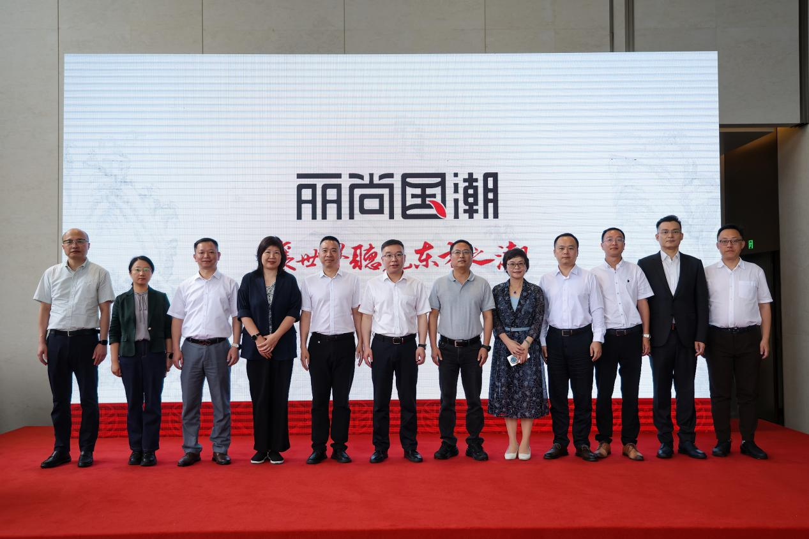
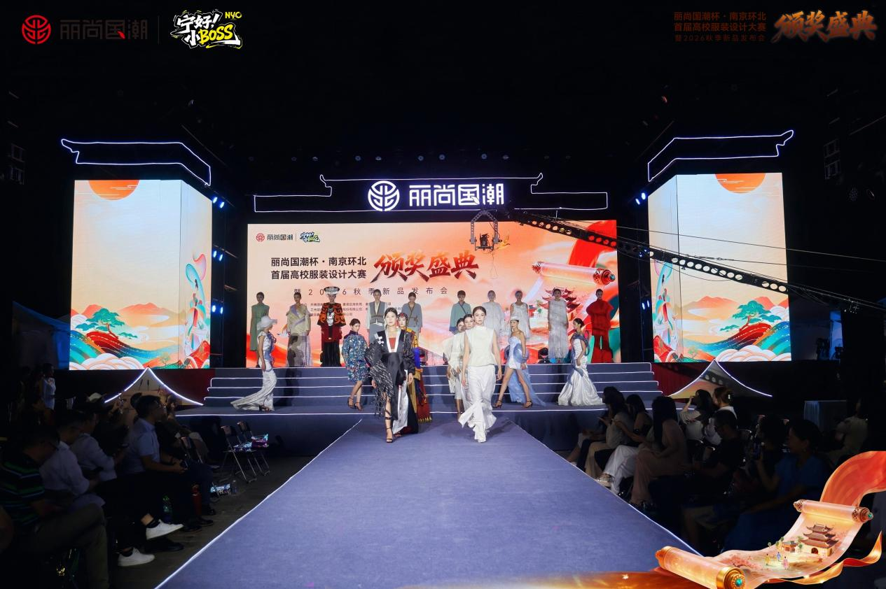

**集团**

一、换届接力稳舵，党建引领

2026 年 3 月，公司第十届董事会任期届满，丽尚国潮依据《公司法》《上市公司独立董事管理办法》及《公司章程》等规定，启动第十一届董事会换届选举。治理是上市公司行稳致远的根基，此次换届既是对法人治理结构的制度化重塑，也是将 \"规范、透明、稳健\" 的治理基因延续至新一届任期的郑重承诺，为集团高质量发展筑牢治理底座。

{width="5.759722222222222in" height="3.8402777777777777in"}

二、校企双向奔赴，产学四维共生

产教融合是集团沉淀人才、链接智力、驱动高质量发展的常态化能力。2026 年，集团将校企合作从单点探索推向体系布局：6 月 25 日，集团与浙江理工大学签署校企全域战略合作协议，围绕产研互促、产教互育、古今互鉴、党业互助四大路径构建产研、产教、文化、党建四维融合校企生态，党委书记吴林与浙理工党委副书记姚珺共同签约，常务副总经理鄢克亚受聘为马兰戈尼时尚设计学院企业导师，杭州环北丝绸服装城教育基金同步揭牌；7 月 20 日，双方举行校外实践基地授牌仪式并开启 \"丽尚学堂\" 公开课，集团获授 \"校外教学实践基地\"、环北获授 \"产教融合实践基地\"，副院长刘丽娴以《谈中国时尚话语体系与国际传播》授课，让学术与商业彼此激活，为国潮从理念走向实践提供务实落点。

{width="5.738194444444445in" height="3.825in"}

在东部时尚高地夯实四维生态的同时，集团将产教融合触角延伸至西北商贸重镇。7 月 16 日，集团旗下亚欧商厦与兰州财经大学签署校企合作协议，围绕订单式人才培育与联合课题研发两条主线，为特色百货零售业务升级铺设学术底座。从东海之滨到陇原大地，一南一北两处落子，勾勒出集团 \"人才＋智库＋区域\" 三位一体的产教融合版图 ------ 在人才共育中沉淀岗位标准，在课题共研中积累决策工具，在双向赋能中培育适配业态与市场特征的组织能力，为集团迈向 \"中国领先的美丽时尚消费产业平台和国潮文化传播平台\" 持续蓄势赋能。

三、乔迁筑巢引凤，焕新铸魂扬帆

6 月 5 日，集团乔迁盛典暨品牌焕新发布会在杭州华润杭曜置地中心举行，政府领导、合作伙伴、媒体代表与集团同仁齐聚见证。董事长吴小波表示，购置杭州核心商圈自持总部物业，是集团深耕美丽时尚产业和国潮赛道的战略举措，为未来十年发展筑牢战略底座，也有助于优化资产结构、提升抗风险能力并预留拓展空间。

{width="5.759722222222222in" height="3.8402777777777777in"}

同步启动的品牌焕新聚焦宋韵根脉与竹魂精神，常务副总经理鄢克亚系统解读全新品牌体系，定制丝巾、小丽 IP 限定手办等伴手礼成为文化载体；新总部以 \"空间即平台\" 理念打造潮启、潮力、潮行、潮星、潮聚五大板块，构建 \"文化为魂、科技为翼、平台为基\" 的国潮产业生态。乔迁与焕新，一为安身立命之基、一为文化灵魂之塑，自持总部是集团对国潮事业的长期主义承诺，品牌焕新则让宋韵竹魂成为贯穿商业运营与传播表达的精神主线，为集团从 \"商业运营者\" 向 \"文化传播者\" 的跃迁写下注脚。

{width="3.9375in" height="0.875in"}

**（新logo）**

{width="1.5756944444444445in" height="1.5722222222222222in"}

（新辅助图形）

四、AI 执笔绘视界，全员共创燃国潮

3 月 30 日，集团 \"智绘国潮・AI 视界\" 首届 AI 视频创作大赛在总部落幕，200 余位领导与同事参与，35 支队伍报名、10 个作品进入决赛展演；常务副总经理鄢克亚提出 \"改变观念，迎难而上，走出舒适，拥抱国潮，用好 AI\" 二十字方针，成为大赛精神纲领与面向未来的行动指南。决赛前最佳人气奖线上票选累计浏览量 52000 次、总票数近 10000 张，杭州环北作品《千年丽尚 国潮传承》以 2935 票摘得桂冠。大赛以 AI 为桥梁，推动守正与创新、传统与未来、地域文化与品牌基因深度融合，是集团创意能力的一次集中检阅，更是拥抱智能时代、推动全员数字化素养跃升的战略动员，以 \"人机协同、文化赋能\" 为内核，为品牌资产数字化沉淀与年轻化表达播下种子。

{width="4.468055555555556in" height="9.669444444444444in"}

**杭州环北**

5.  采批节

    （服装批发市场内部，主要是女装，可以在宣传画上写"环北采批节"）

**南京环北**

六、青春设计聚金陵，国潮大秀映城墙

7 月 29 日晚，\"丽尚国潮杯・南京环北首届高校服装设计大赛\" 颁奖盛典暨 2026 秋季新品发布会在南京老门东举行，活动以 \"守正创新 AI 国潮\" 为主题，由共青团南京市委、秦淮区洪武路街道、秦淮区商务局指导，丽尚国潮实业集团（600738）、南京环北服装批发市场联合主办，直播总观看 4.4 万人次、曝光量 69 万次、涨粉近 3000 人。赛事辐射苏皖粤等七省 21 所高校、累计对接院校超 30 所，吸引 187 名设计学子参赛，38 组 AI＋国潮原创成衣登上老门东秀场，江南影视艺术职业学院学子斩获金奖，5 所高校授予南京环北 \"实践教学基地\"，并官宣第二届大赛启动。从校园到秀场、从设计到产业，这场大赛把高校的创意势能转化为品牌的原创资产，把 Z 世代的审美认同沉淀为产品的市场增量，昭示着国潮生生不息、代代传承的青春动能。

{width="5.748611111111111in" height="3.827777777777778in"}

**亚欧商厦**

七、三十二载融金城MINSON LAND甘青宁首店开业

丽尚国潮旗下亚欧商厦迎来 32 周年店庆，为期四天的周年盛典圆满收官：线上全域曝光突破 818.5 万次、全网新增粉丝逾万，线下单场活动客流稳定突破 5000 人次，客流、人气、业绩三重突破。店庆以多圈层内容矩阵构建城市事件，儿童风尚大秀、夏日燃动健身节、周杰伦主题歌友会、国潮动漫与王者荣耀 COS 巡游等覆盖亲子、健康、音乐、次元多元圈层；夜经济与稀缺体验成为转化亮点，整点抽免单、超市日间 7 折夜间 6.6 折并延长营业至午夜，2 米长、204 公斤蓝鳍金枪鱼现切开鱼制造话题爆点，\"全城溜鹅\" 以 2000 只大鹅气球成为现象级传播符号。此次店庆不仅展现亮眼数据，更证明实体商业在共处、共鸣与共情中的不可替代价值，是亚欧商厦从 \"购物场所\" 向 \"城市生活方式目的地\" 的身份进阶，也是集团深耕线下消费场景、推动区域商业升级的生动实践。

MINISO LAND将于11月底开业。（可用miniso land的logo）

亚欧国际

八、观光厅招商成功
